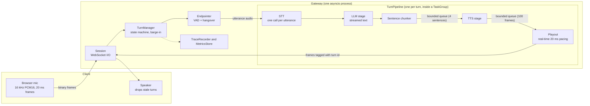
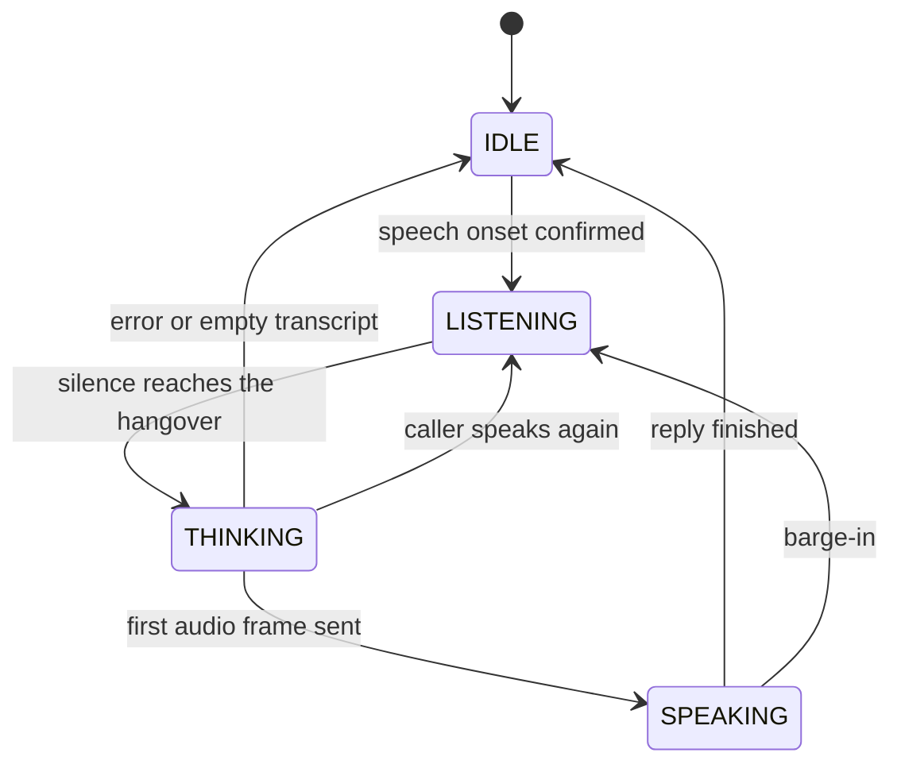
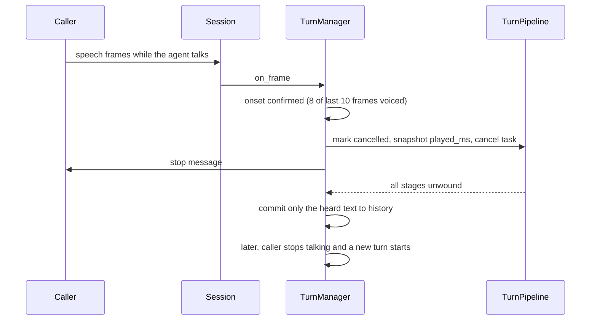

# Architecture

Voice Gateway is the **timing layer** between a caller and three AI services: speech-to-text (STT), a language model (LLM), and text-to-speech (TTS). It does not do any AI itself. Its job is conversational timing: when the caller is done, how soon the agent can start, how fast it stops when interrupted, and what the agent should remember.

This document explains how it is built and why. Measured results are in [results.md](results.md); how to run it is in the [README](../README.md).

## 1. Goals and non-goals

**Goals**
- Start speaking as early as possible, by streaming sentence by sentence instead of waiting for the full reply.
- Stop within a fraction of a second when the caller interrupts, with no stale audio leaking out afterwards.
- Keep the conversation memory truthful: after an interruption, remember only what the caller actually heard.
- Contain failures: a slow or broken provider must not wedge a live call.
- Make every claim measurable: trace every stage, and benchmark against an ablated "naive" baseline.

**Non-goals**
- Building or tuning AI models. The three services are interchangeable behind an interface.
- Telephony (SIP/PSTN). The client is a browser over WebSocket.
- Production hardening: authentication, multi-process scaling and persistence are out of scope (see section 12).

## 2. System overview



| Component | File | Responsibility |
|---|---|---|
| Session | `src/vgw/session.py` | One per WebSocket. Re-frames incoming audio into 20 ms frames, owns the conversation and trace recorder. |
| TurnManager | `src/vgw/turn_manager.py` | State machine, turn ids, barge-in, cancellation, history commit. |
| Endpointer | `src/vgw/vad.py` | Turns per-frame voice-activity flags into `SpeechStarted` / `SpeechEnded(audio)`. Counts frames, never reads a clock. |
| TurnPipeline | `src/vgw/pipeline.py` | STT, then LLM, TTS and Playout as concurrent stages. |
| SentenceChunker | `src/vgw/chunker.py` | Splits the LLM's token stream into sentences TTS can start on. |
| Conversation | `src/vgw/history.py` | History, truncate-to-spoken, optional window cap. |
| Providers | `src/vgw/providers/` | Interfaces, Groq and edge-tts adapters, and stub providers with latency and fault injection. |
| Tracing | `src/vgw/tracing/` | Event schema, recorder, per-turn metrics, rolling store. |
| Server | `src/vgw/server.py` | FastAPI app: `/ws`, `/api/metrics`, `/api/process`, `/health`, static client and dashboard. |

All audio inside the gateway is **PCM16, mono, 16 kHz, in 20 ms frames (640 bytes)**. Provider adapters convert at the edges.

## 3. Wire protocol

| Direction | Type | Content |
|---|---|---|
| client to server | binary | PCM16 mono 16 kHz audio, any chunk size |
| server to client | binary | 4-byte big-endian turn id, then one 20 ms PCM16 frame |
| server to client | text | `{"type": "stop", "turn_id": N}`: stop playing and drop buffered audio for turns up to N |

The browser client resamples the microphone to 16 kHz in an AudioWorklet, requests echo cancellation, and ignores any audio frame whose turn id is at or below the last stopped turn, so a late network packet cannot revive an interrupted reply.

## 4. Life of a turn

A **turn** is one caller utterance plus the agent's reply. Each turn gets an id when the caller's speech begins.



1. **Endpointing.** The Endpointer collects audio. Onset is confirmed when enough recent frames are voiced: 3 of 3 when the agent is silent, **8 of the last 10** while the agent is speaking. The utterance ends after `hangover_ms` (600 ms) of silence. A short pre-roll is kept so the first syllable is not clipped.
2. **STT.** One call per finished utterance. This is why request/response APIs such as Whisper work: the gateway decides where utterances end, not the STT service.
3. **LLM and TTS stream concurrently.** The chunker releases the first clause (after at least 20 characters) or sentence. TTS starts on it while the LLM is still writing.
4. **Playout** sends the audio at real-time speed, one frame per 20 ms, with the first frame going out immediately.
5. **Turn end.** The spoken text is committed to the history, trace events are emitted, and the manager returns to IDLE.

Trace events for one turn, in order: `speech_start`, `speech_end` (the last voiced frame, recorded retroactively), `endpoint`, `turn_start`, `stt_start/end`, `llm_start`, `llm_first_token`, `llm_first_sentence`, `tts_start`, `tts_first_audio`, `audio_out_first`, `audio_out_last`, `turn_end`.

## 5. Barge-in



The order is deliberate, because what the caller perceives is the moment the audio stops:

1. Mark the turn **cancelled** (synchronous). Playout checks this flag before every frame, so nothing more is sent.
2. **Snapshot** how much audio was played, before anything else changes.
3. **Cancel** the turn's task (synchronous). The `TaskGroup` unwinds the LLM, TTS and playout stages and closes the HTTP stream to the LLM.
4. **Tell the client to stop**: the one `await` on the critical path.
5. **Wait** for the cancelled work to finish, bounded by `cancel_timeout_s` (1 s).
6. **Commit** only the spoken text to the history.

**Carry-over.** If the caller speaks again while the previous utterance was still being transcribed, that audio is not discarded. It is prepended to the next utterance, so one thought split by a long pause is transcribed as one.

**Noise guard.** The stricter onset while the agent speaks (8 of 10 frames) is why measured cut-off is about 140 ms: the guard waits for sustained speech so that coughs, noise and "mm-hmm" do not cut the agent off.

## 6. Streaming pipeline and backpressure

STT runs first. Then three stages run inside one `asyncio.TaskGroup`, connected by bounded queues:

```
LLM stage --chunk_q (4 sentences)--> TTS stage --playout queue (100 frames = 2 s)--> Playout --> client
```

- **Backpressure.** A slow client fills the playout queue, which blocks TTS, which fills `chunk_q`, which blocks the LLM stage. Nothing buffers without limit.
- **Structured cancellation.** Cancelling the turn task cancels all three stages and waits for them. A test asserts the asyncio task count returns to baseline after a barge-in and after a disconnect.
- **Provider cancellation contract.** Providers must let `CancelledError` propagate and release network resources in `finally` / `async with`. Streams are consumed under `contextlib.aclosing`.
- **Pacing.** TTS is usually faster than real time. If audio were forwarded immediately, the client would buffer seconds of speech and a barge-in could not stop it. Pacing keeps "audio sent" within a small buffer of "audio heard", which is also what makes truncate-to-spoken accurate. If TTS starves, the schedule is re-anchored instead of bursting frames to catch up.
- **Queue sizing.** The playout queue holds 2 s so that the next sentence can be synthesized while the current one plays.

## 7. Conversation memory

When the caller interrupts, the LLM has already generated more than they heard. Storing the full reply would make the model believe it said things the caller never heard.

`AssistantUtterance` records each spoken chunk as a segment with its audio duration. After an interruption, `spoken_text(played_ms)` maps the amount of audio actually played onto the segments, and cuts a partly played segment at a **word boundary, rounded down**. The history stores that text plus a marker (`[interrupted by user]`), and the system prompt tells the model what the marker means.

Assumptions, stated plainly:
- Speech has an even rate within a chunk (the cut inside a chunk is approximate).
- `played_ms = sent_ms - client_buffer_ms`, where the client buffer is estimated at 40 ms.
- Word-level cuts need space-separated text, which covers English, Hindi and Telugu but not, for example, Chinese.
- A chunk whose TTS is still running is not assumed to be complete: its duration is estimated from its length.

Tool calls and tool results are never truncated, because their side effects really happened. An optional window cap (`max_history_messages`, default 40) drops the oldest turns but always starts the window at a user message, so a tool result is never separated from its call.

## 8. Failure handling and invariants

Provider failures are classified as `ProviderError` (with a `transient` flag) or a timeout, and wrapped as a `StageError` naming the stage and provider. Timeouts cover STT, the LLM's first token, and the first audio of every TTS chunk. The turn then ends with outcome `error`, a trace event is emitted, any partly spoken reply is committed with a marker, and the session stays usable.

Invariants the code and tests aim to maintain:

1. At most one active turn per session.
2. After an interruption, no audio for that turn is sent, and the client drops late frames by turn id.
3. The history contains only text the caller heard.
4. **However a turn ends, the manager returns to IDLE.** A bookkeeping bug may lose a trace counter, but it must not leave a live call stuck. This invariant was added after a test run exposed exactly that failure.
5. A client disconnect cancels the turn and leaks no tasks.

Not built: spoken recovery for the caller (today a failed turn means silence plus a trace event), retries, and provider failover.

## 9. Observability

Every stage emits `TraceEvent`s (monotonic `perf_counter_ns` timestamps, which are high-resolution on Windows where `monotonic` can tick at about 15 ms). `turn_metrics` converts a finished turn's events into a `TurnMetrics` record:

- **Latency:** time to first audio, endpointing wait, STT, LLM first token and first sentence, TTS first audio, barge-in cut-off, cancel time.
- **Efficiency (characters, a stand-in for tokens):** written by the LLM, sent to TTS, actually heard, and LLM input size.

A bounded rolling `MetricsStore` keeps the last 500 turns across sessions. `/api/metrics` serves the summary (p50/p95/p99) and recent turns; `/dashboard.html` polls it and draws a per-turn breakdown. The terminal also prints one summary line per turn.

## 10. Providers

```python
class STTProvider:  async def transcribe(pcm, *, language) -> Transcript   # one finished utterance
class LLMProvider:  def stream(messages, *, tools)  -> AsyncIterator[LLMDelta]
class TTSProvider:  def synthesize(text, *, language) -> AsyncIterator[bytes]  # PCM16 16 kHz
```

| Provider set (`VGW_PROVIDERS`) | What it is |
|---|---|
| `stub` | Fake providers; TTS plays a beep. Enough to test turn-taking by ear. |
| `bench` | Silent audio, zero simulated latency: isolates the gateway's own cost. |
| `bench-real` | Silent audio with realistic latencies, for comparing gateway modes. |
| `groq` | Groq Whisper (`whisper-large-v3-turbo`), a Groq-hosted `gpt-oss` model with low reasoning effort, and edge-tts decoded to PCM with ffmpeg. |

The stub providers sample latency from a lognormal distribution with an optional slow tail, and can inject errors, stalls and mid-stream failures, all seedable. Adding a provider means implementing one interface and registering it in `providers/registry.py`; nothing else changes.

## 11. Evaluation methodology

`eval/loadgen.py` runs simulated callers over real WebSockets, streaming 20 ms frames in real time (tone as speech, zeros as silence), with the server using a trivial synthetic VAD so the VAD cost does not distort the measurement. Times are measured **from the caller's side**: last speech frame sent to first agent audio frame received.

- **Validity guard.** The load generator counts frames that left more than 40 ms late. A run is marked valid only if under 1% were late and no caller failed, so a slow load generator is not mistaken for a slow server.
- **Isolation.** `eval/run_benchmarks.py` starts a fresh server process per configuration.
- **Ablation, not a strawman.** `VGW_MODE=naive` runs the same code with sentence streaming and barge-in switched off.
- **Server cost.** `/api/process` reports server CPU time and memory, from which CPU per session-second is computed.
- **Known measurement limits.** Server and load generator share one machine. On Windows the event-loop timer resolution is about 15 ms, which limits the resolution of the overhead figures. Quote comparisons between rows, not absolute capacity.

## 12. Configuration reference

Environment variables (all optional; real environment variables override `.env`):

| Variable | Meaning |
|---|---|
| `VGW_PROVIDERS` | `stub`, `bench`, `bench-real`, `groq` |
| `VGW_VAD` | `webrtc` (real microphones) or `synthetic` (load tests) |
| `VGW_VAD_AGGRESSIVENESS` | 0 to 3; higher filters more noise |
| `VGW_MODE` | `gateway` or `naive` |
| `VGW_LANGUAGE` | `en`, `hi`, `te`; empty means auto-detect |
| `VGW_HANGOVER_MS`, `VGW_BARGE_IN_MS` | override the endpointing knobs |
| `VGW_LOG_LEVEL` | e.g. `WARNING` during load tests |
| `GROQ_API_KEY`, `GROQ_LLM_MODEL`, `GROQ_STT_MODEL`, `GROQ_REASONING_EFFORT` | for the `groq` provider set |

`GatewayConfig` defaults (`src/vgw/config.py`):

| Setting | Default | Effect |
|---|---|---|
| `onset_ms` / `barge_in_onset_ms` | 60 / 200 | Speech needed to start a turn / to interrupt the agent |
| `onset_ratio` | 0.8 | Share of voiced frames required in the onset window |
| `hangover_ms` | 600 | Silence that ends the caller's turn: the main latency vs cut-off knob |
| `preroll_ms` / `tail_ms` | 200 / 100 | Audio kept before onset / after the last voiced frame |
| `max_utterance_ms` | 15000 | Force-end very long utterances |
| `first_chunk_min_chars` | 20 | Earliest clause-boundary flush of the first sentence |
| `max_history_messages` | 40 | Safety cap for very long calls |
| `chunk_queue_size` / `playout_queue_frames` | 4 / 100 | Bounded queue sizes (backpressure) |
| `client_buffer_ms` | 40 | Assumed client playback buffer, subtracted when computing what was heard |
| `stt_timeout_s`, `llm_first_token_timeout_s`, `tts_first_audio_timeout_s` | 8 each | Stage timeouts |
| `cancel_timeout_s` | 1 | How long barge-in waits for cancelled work |
| `stream_sentences`, `barge_in_enabled` | true, true | Ablation switches; both false is the naive baseline |

## 13. Design decisions and trade-offs

| Decision | Why | Cost |
|---|---|---|
| Endpointing with VAD plus a silence hangover | Provider-independent; works with request/response STT | 600 ms of the latency budget; shorter cuts off slow talkers |
| Per-utterance STT | Any STT API works | The caller's speech is not transcribed while it is spoken |
| Stricter onset while the agent talks | Noise and "mm-hmm" do not interrupt | About 140 ms before the agent stops |
| Bounded queues | Nothing grows without limit; stalls propagate | Can add a small gap between sentences if TTS is slower than playback |
| One TaskGroup per turn | Cancellation cannot leak tasks | One more concurrency primitive to reason about |
| Real-time pacing of output | Accurate cut-off and truncate-to-spoken | A paced sender per active session |
| VAD and barge-in run inline in the receive loop | Lowest latency, no extra hop | The loop waits (at most `cancel_timeout_s`) during a barge-in |
| Truncate-to-spoken with a uniform-rate assumption | Cheap and independent of the TTS engine | Approximate inside a chunk |
| TTS decoded in full per sentence (version 1) | Simple and robust | Adds to time to first audio; streaming decode is the next optimization |
| Synthetic VAD in load tests | A real VAD in the hot path would distort the benchmark | Load tests cover the gateway, not VAD accuracy |

## 14. Limitations and future work

- No tool-calling loop. `LLMDelta.tool_call` is carried through the interfaces but ignored, and the history already handles tool messages correctly.
- No spoken recovery or provider failover after a failure.
- Whisper can hallucinate text on pure noise; Whisper's no-speech scores are not used yet.
- No authentication on `/ws`, `/api/metrics` or the dashboard: local use only.
- Metrics live in memory and reset on restart.
- One process holds about 100 callers on the test machine; scaling out needs several processes behind a load balancer with sticky WebSocket routing, which is untested.
- The voice for each reply is chosen by script of the text (Devanagari, Telugu, otherwise English), which assumes the LLM replies in the caller's language.
- edge-tts uses an unofficial endpoint and may need upgrading if it changes.
- Possible optimizations: streaming TTS decode, speculative STT start after a short silence (cancelled if the caller resumes), and prompt-cache-aware history handling.

## 15. Code and test map

```
src/vgw/
  audio.py        constants, PCM helpers, FrameSplitter
  vad.py          VAD adapters and the Endpointer
  chunker.py      sentence chunker
  history.py      AssistantUtterance, Conversation
  pipeline.py     Playout, TurnPipeline, StageError
  turn_manager.py TurnManager: state machine and barge-in
  session.py      WebSocket session
  server.py       FastAPI app
  config.py       GatewayConfig
  providers/      base interfaces, stubs, Groq and edge-tts adapters, registry
  tracing/        events, recorder, metrics
client/           browser client and dashboard
eval/             load generator and benchmark runner
tests/            see below
```

| Test file | What it demonstrates |
|---|---|
| `test_vad.py` | Onset, hangover, pre-roll, flicker tolerance, runtime onset change |
| `test_chunker.py` | Sentence and clause splitting, decimals and abbreviations, Hindi danda, hard cap |
| `test_history_truncation.py`, `test_history_cap.py` | Truncate-to-spoken, markers, tool messages preserved, window cap |
| `test_turn_manager.py` | Full turn, barge-in order, stale-audio guard, carry-over, error containment, timeouts, no task leaks, ablation modes, efficiency counters |
| `test_metrics.py`, `test_tracing.py` | Metrics derivation, percentiles, bounded stores |
| `test_server.py` | WebSocket round trip, stop message, metrics endpoint |
| `test_providers_helpers.py` | WAV encoding, voice selection, message conversion, ffmpeg decoding |
| `test_stubs.py`, `test_audio.py` | Stub latency and faults, cancellation promptness, frame splitting |